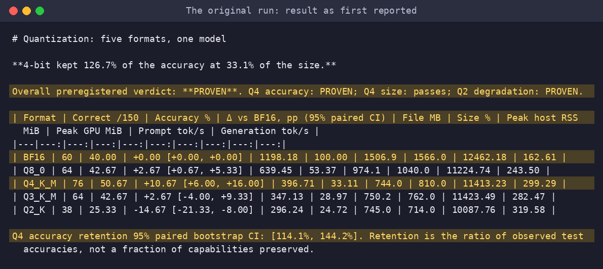
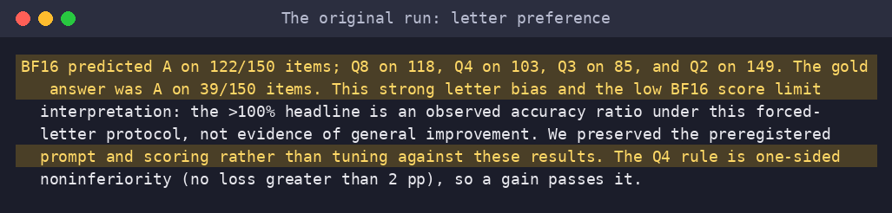
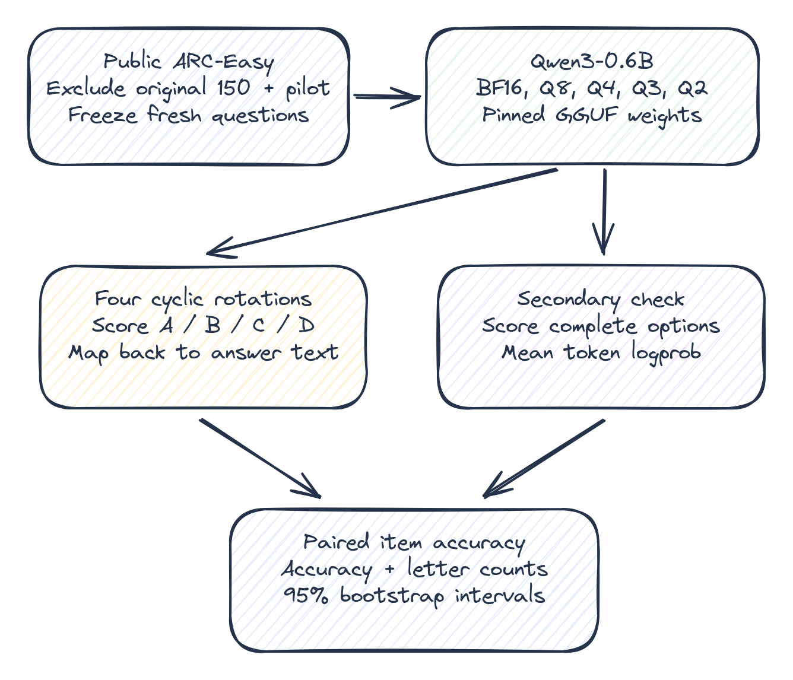
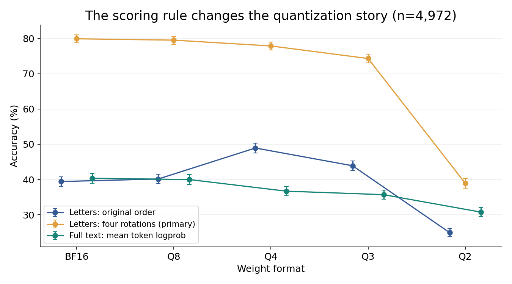
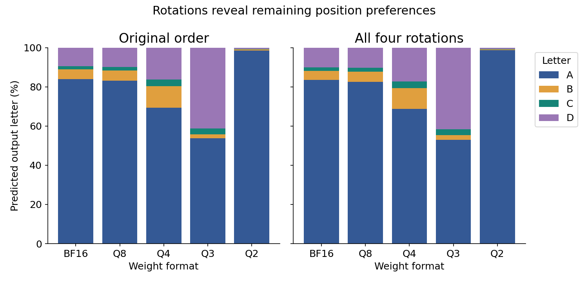
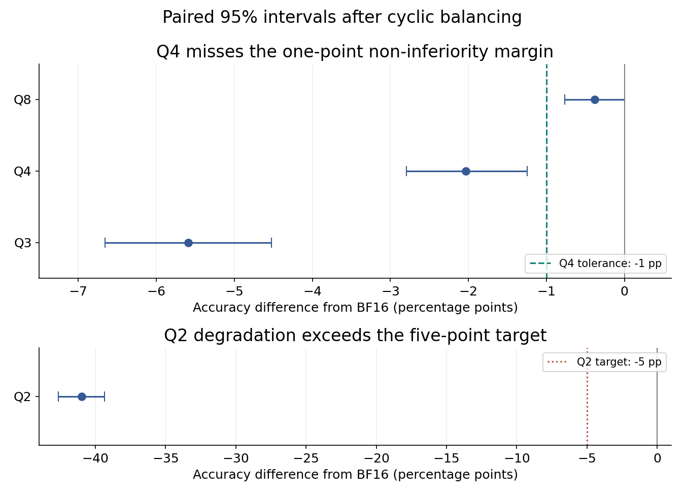
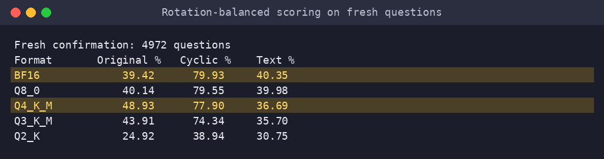
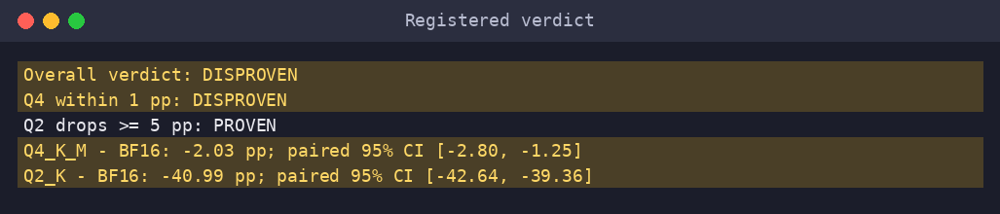

# Q4 lost 2.03 points once I balanced the answer letters

A quantization result that looked like an improvement was also a test of how much a model liked the letter A.

The popular promise is that four-bit models preserve quality while taking much less space. The [GPTQ paper](https://arxiv.org/abs/2210.17323) describes “negligible accuracy degradation” for its own models and quantization method. That is an attractive engineering trade: fit a model on cheaper hardware without paying much in wrong answers. It is not a guarantee for every model or every scoring script.

My headline from this rerun is **-2.03 percentage points for Q4 versus BF16**, after balancing the option letters. That is the number I would carry forward, with its uncertainty, rather than my first run's apparent improvement.

## What I expected, and what the first run said

I expected moderate compression to preserve most accuracy and aggressive compression to hurt. For this follow-up I registered two concrete claims: Q4 would stay within one percentage point of BF16, and Q2 would lose at least five points. One extra mistake per hundred questions was my practical Q4 tolerance.

The [original run's writeup](results/earlier_writeup.md) sounded much better than that: “4-bit kept 126.7% of the accuracy at 33.1% of the size.” Its table recorded BF16 at 40.00%, Q4 at 50.67%, and Q2 at 25.33%. Those were 60, 76, and 38 correct answers out of 150. The reported Q4 difference was +10.67 percentage points, with a paired interval of [6.00, 16.00].

The archived writeup reported a Q4 gain and a passing verdict.

I am preserving those numbers because the correction is the story. Replacing them with the rerun would hide why I needed another experiment.

## Why I got suspicious

BF16 predicted A on 122/150 items. The gold answer was A on only 39/150. Q2 chose A on 149/150. Q4 chose A less often, on 103/150, and scored better.

The original writeup recorded the predicted-letter counts and the mismatched gold distribution.

Imagine a model that understands a question but also gives a large bonus to the first answer label. A weight change that weakens that bonus can improve a multiple-choice score without improving the underlying science knowledge. A leaderboard can accidentally reward a different formatting preference.

That pattern does not prove that every extra Q4 answer came from letter bias. It does make a broad claim about improved capability hard to defend. I needed a test where each answer took a turn wearing each letter.

## The flaw, and the fix

There is an easy but ineffective repair here: replace raw logits with log probabilities and call the measurement corrected. Within one prompt, that changes the scale and leaves the winning letter unchanged. The first experiment was already ranking letter logits, not sampling long answers. There was no decoding randomness to average away.

I kept its letter prompt and used four cyclic rotations. If the original options were A, B, C, D, the next version moved the first option to the end. After four versions, every content answer had occupied every position.

For each version I measured the probability of A, B, C, and D as the next token. I mapped those scores back to the original answer texts and averaged their log probabilities. A fixed additive preference for A then contributes equally to every answer. More complicated interactions with option order can survive, so I call this balancing rather than a universal cure.

The diagram shows the two scoring paths. Four rotations produce one primary answer per question; a separate full-text check asks whether the conclusion depends on predicting a letter at all.

## What I tested

I used Qwen3-0.6B in exactly the five [pinned Unsloth GGUF formats](https://huggingface.co/unsloth/Qwen3-0.6B-GGUF/tree/50968a4468ef4233ed78cd7c3de230dd1d61a56b) from the first experiment: BF16, Q8_0, Q4_K_M, Q3_K_M, and Q2_K. All ran on NVIDIA L4 GPUs, one allocation at a time, with llama-cpp-python 0.3.36 and the same non-thinking chat structure. Downloaded weight hashes were verified. The first VM disappeared; I resumed its saved rows on a replacement L4.

A disjoint pilot used 32 ARC-Easy training questions. BF16 got 28 correct after balancing, Q4 got 25. Their correctness disagreed on three questions. That implied roughly 7,361 questions for 80% power to establish the one-point margin if the true gap were zero.

There were only 4,972 fresh, deduplicated four-choice ARC-Easy questions available across the public training, validation, and test splits after exclusions. I used all of them. That gives about 63% planned power, not 80%. I committed the sample and that shortfall before confirmation. The earlier 150 questions and the pilot stayed out.

The secondary check scored each complete answer text by its average token log probability, using an instruction requesting the exact answer text. It is a different prompt and metric, not an interchangeable estimate of the primary result. Raw records include actual model token IDs, token scores, and counts. No paid model judged the answers.

## The real answer

BF16 reached 79.93% on the balanced score. Q4 reached 77.90%, a difference of -2.03 points with a 95% paired interval of [-2.80, -1.25]. Q8 reached 79.55%, Q3 74.34%, and Q2 38.94%.

This chart puts the original-order letters, balanced letters, and full answer texts on the same fresh questions. Their disagreement is part of the result, not a reason to pick the most flattering line.

On original-order letters, BF16 scored 39.42% and Q4 48.93%. BF16 chose A 4,174/4,972 times; Q4 chose it 3,447/4,972 times. With full answer-text likelihood, they scored 40.35% and 36.69%. The label-free check does not magically become ground truth; token normalization and instruction following matter too. BF16's roughly forty-point jump between original and balanced letters is itself a warning: the evaluator is a major part of what this benchmark measures.

Balancing the score does not force the model to predict A, B, C, and D equally often. This chart shows the physical output letters before mapping them back to answer identities, including preferences that remain across rotations.

The intervals resample whole questions, keeping BF16 and each quantized result paired. The vertical reference lines mark the one-point Q4 tolerance I registered for this rerun and five-point Q2 degradation target.

My one-point Q4 promise failed. The entire confidence interval was below the tolerance I had written down before the run. The Q2 degradation prediction passed. Q2's balanced difference was -40.99 points, with interval [-42.64, -39.36]. The overall registered verdict is DISPROVEN.

These are the three scoring methods on the same fresh questions.

The program applies the original margins to paired confidence intervals.

## What surprised me, and what I got wrong

The mistake was treating a passing statistical rule on a biased measurement as a broad engineering conclusion. The first writeup did flag letter bias. That caveat did not turn the headline into a clean comparison of capability. The first run's confidence interval measured sampling uncertainty under its scorer. It did not test whether the scorer was measuring what I wanted.

I also underestimated the sample size needed for a one-point promise. Thousands of questions can still leave an awkward interval when the models disagree on enough individual items. More decoding seeds would not fix that here: these are deterministic likelihood comparisons on fixed weights.

The runtime checks did not reveal a gross logit-extraction failure. The old and new extraction paths selected the same letter on a pilot probe, with small numerical differences. An initially overstrict numerical tolerance failed, and that failure remains in the logs. The corrective evidence is the fresh scoring comparison, not a story about a conveniently broken library.

## What I would do in production

1. Log predicted-label frequencies alongside accuracy. Compare them with the gold distribution before discussing a quantization win.
2. Rotate option positions on an audit slice. Map predictions back to answer identities, and keep all rotations of one question together in statistical analysis.
3. Set the acceptable error increase before testing. Calculate the needed paired sample size rather than assuming a few hundred examples can resolve one point.
4. Evaluate the exact interaction users will see. A letter-ranking benchmark and generated answers exercise different behavior; neither should silently stand in for the other.

## Limitations

This is one small model on school science questions, with prebuilt mixed-precision GGUF artifacts. It does not isolate bit width from the quantization recipe, establish general reasoning quality, or prove the questions were absent from model training. Fresh means unused by these experiments.

Using all dataset splits improved precision but changed the population from the earlier test-only sample. Exact deduplication does not remove every paraphrase. Four rotations remove a simple position preference, not every ordering effect. The pilot and confirmation were disjoint items from the same benchmark, not a cross-dataset replication. The confidence intervals cover question sampling, not all those choices.

A post hoc check of the fresh test split alone gave Q4 a -1.68-point difference, with interval [-2.86, -0.54]. That subset is too imprecise to decide the one-point margin; it does not replace the registered full-pool result.

The useful habit is to inspect what a score rewards before deciding what a smaller model preserved.

Code and raw results are in this repository.
